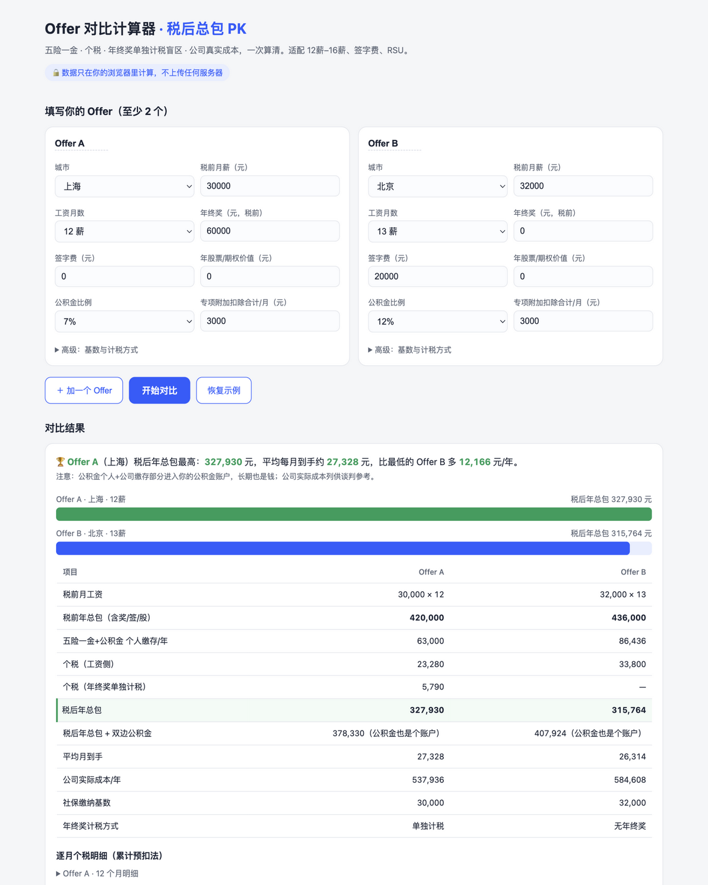

# Offer Compare CN · 多 Offer 税后对比计算器

> 并排对比 2-3 个中国 offer 的**税后**年总包：五险一金、个税、年终奖单独计税盲区提醒、公司真实成本。
> 纯本地计算——数据不出浏览器，无登录、无后端、无统计。



## 使用

打开 `index.html` 即可（双击本地打开，或部署到任意静态托管）。填写至少 2 个 offer，点「开始对比」。

功能清单：

- 2-3 个 offer 并排：税前月薪 × 月数（12-16薪）、年终奖、签字费、RSU/期权、公积金比例（5%-12%）、专项附加扣除
- 四种口径对比：税后年总包 / 税后年总包+双边公积金 / 平均月到手 / 公司实际成本
- **年终奖单独计税盲区自动检测**（36,000 / 144,000 / 300,000 / 420,000 / 660,000 / 960,000 六个临界点，边界值经程序暴力验证）
- **计税方式自动择优建议**：单独计税 vs 并入综合所得，哪个更优会提示差多少
- **逐月累计预扣明细 + 累计到手现金流曲线**
- 13 城社保基数内置（北京/上海/深圳/杭州/广州/成都/武汉/南京/西安/天津/长沙/合肥/济南，来源见源码注释），其他城市可在「高级」中手动改
- 复制文本结果 / 复制分享链接（方案编码进 URL，无服务器参与）

## 计算口径与数据来源

- 个税税率表：[《个人所得税法》官方原文（总局法规库）](https://fgk.chinatax.gov.cn/zcfgk/c100009/c5193028/content.html)、[税率表官方 PDF](https://shanghai.chinatax.gov.cn/zcfw/zcfgk/grsds/202402/P020240202362406243753.pdf)
- 年终奖单独计税：[财政部 税务总局公告 2023 年第 30 号](https://fgk.chinatax.gov.cn/zcfgk/c102416/c5211524/content.html)（执行至 2027-12-31）
- 专项附加扣除：国发〔2023〕13 号现行标准
- 各城市社保/公积金基数：人社局/政府官网公告（逐条 URL 见 `engine/tax-engine.mjs` 源码注释），每年 7-8 月调整后需更新
- 完整假设与免责声明见页面底部

## 开发

```bash
node --test engine/tax-engine.test.mjs   # 19 组单元测试（含盲区边界暴力验证）
node build.mjs                            # 引擎内联进模板，产出单文件 index.html
```

目录结构：`template.html`（UI）+ `engine/tax-engine.mjs`（纯函数计算引擎）+ `build.mjs`（内联构建）。
修改 UI 后记得重新 `node build.mjs`。

## 免责声明

估算工具，不构成税务建议。年中入职的汇算差异、期权行权单独计税等场景未建模；各城市基数每年调整，请以当地人社局公布为准。

## License

MIT
